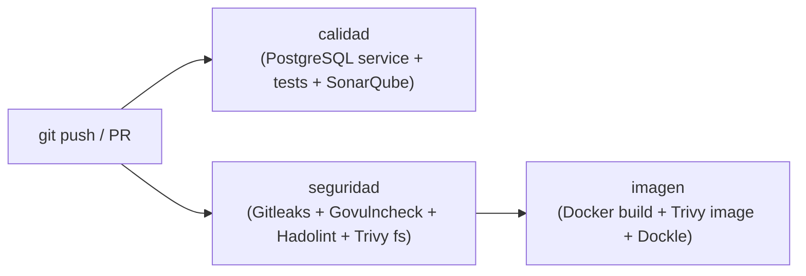

# Microservicio Ejemplo — Tareas (DAS)

Repositorio base del microservicio de gestión de tareas siguiendo los lineamientos técnicos del curso **DAS (Desarrollo de Microservicios)**.

### Enlaces de Evidencia
* **Pipeline de CI (GitHub Actions):** [https://github.com/benbuselola/ejemplo-pingeso/actions](https://github.com/benbuselola/ejemplo-pingeso/actions)
* **Panel de SonarQube:** [http://localhost:9000/dashboard?id=ejemplo-pingeso](http://localhost:9000/dashboard?id=ejemplo-pingeso) (Clave del proyecto: `ejemplo-pingeso`)

---

## 1. Cosa faltante

| **Protección de Rama `main`** | ⚠️ Configuración | Requiere activar en GitHub: Settings > Branches > Require PR (1 aprobación) y checks obligatorios `calidad`, `seguridad`, `imagen`. |

---

## 2. Composición y Estructura del Repositorio

El proyecto implementa una arquitectura desacoplada basada en contratos (**API-First**) y principios de **Clean Architecture** y **Shift-Left Security**.

```text
ejemplo-pingeso/
├── apps/
│   ├── api/                          # Backend en Go
│   │   ├── config/                   # Conexión e inicialización de PostgreSQL (pgx/v5)
│   │   │   ├── db.go                 # Conexión sql.DB, timeouts y pool de conexiones
│   │   │   └── db_test.go            # Pruebas de integración de base de datos y esquema
│   │   ├── controllers/              # Controladores HTTP y CORS seguro
│   │   │   ├── tarea_controller.go   # Handlers REST con sentencias SQL parametrizadas
│   │   │   └── tarea_controller_test.go # Pruebas unitarias de endpoints, validaciones y CORS
│   │   ├── models/                   # Estructuras de datos nativas
│   │   │   ├── tarea.go              # Entidad Tarea (ID UUID, Título, Estado)
│   │   │   └── tarea_test.go         # Pruebas de estructura y parseo de datos
│   │   ├── Dockerfile                # Multi-stage build con usuario no-root numérico (10001:10001)
│   │   ├── go.mod                    # Módulos Go (Go 1.26.0 + toolchain go1.26.10, pgx v5.10.0)
│   │   ├── go.sum                    # Checksums verificados de dependencias
│   │   ├── main.go                   # Punto de entrada de la API (/healthz, /readyz, /api/tareas)
│   │   └── main_test.go              # Pruebas de liveness, readiness y enrutamiento
│   └── web/                          # Frontend SPA (Vue.js / Vite)
│       ├── src/                      # Componentes Vue y estilos
│       ├── Dockerfile                # Multi-stage build con nginx-unprivileged (USER 101:101)
│       ├── nginx.conf                # Configuración Nginx escuchando en puerto 8080
│       ├── package.json              # Dependencias y scripts de frontend
│       └── package-lock.json         # Lockfile de dependencias npm
├── contracts/
│   └── openapi.yaml                  # Contrato OpenAPI 3.1 publicado (API-First, con /healthz y /readyz)
├── docs/
│   └── modos-de-falla.md             # Matriz de resiliencia y modos de falla (Sección 9)
├── .github/
│   └── workflows/
│       └── ci.yml                    # Pipeline de CI con servicio PostgreSQL para tests de cobertura
├── .dockerignore                     # Archivos excluidos del contexto Docker (.git, .env*, coverage.out)
├── .env.example                      # Plantilla de variables de entorno con valores replace-with-*
├── .gitignore                        # Exclusiones de Git (.env, coverage.out, .scannerwork/)
├── .trivyignore.yaml                 # Excepciones autorizadas para Trivy (con CVE y fecha)
├── docker-compose.yaml               # Orquestación local (PostgreSQL 17, API y Web con name fijo)
├── sonar-project.properties          # Configuración SonarQube (rutas de cobertura y exclusión de tests)
└── README.md                         # Documentación general y evidencias del proyecto
```

---

## 3. Stack Tecnológico y Reglas Obligatorias

| Componente | Tecnología / Versión | Consideraciones del Estándar DAS |
| :--- | :--- | :--- |
| **Backend** | Go `1.26.10` | `go 1.26.0` con `toolchain go1.26.10` para subsanar vulnerabilidades de la biblioteca estándar (`crypto/x509` y `net/http`). |
| **Driver BD** | `github.com/jackc/pgx/v5` `v5.10.0` | Versión exacta exigida en la pauta oficial, libre de vulnerabilidades críticas. |
| **Frontend** | Vue 3 + Vite | Servido mediante Nginx en contenedor no privilegiado (`UID 101:101`) en puerto interno `8080`. |
| **Base de Datos** | PostgreSQL `17-alpine` | Contenedor aislado en Compose con healthcheck `pg_isready` y migración completa desde MongoDB. |
| **Contrato** | OpenAPI `3.1.0` | Especificación estricta de rutas, parámetros, respuestas de error RFC 9457 y endpoints `/healthz` y `/readyz`. |
| **Observabilidad** | Healthchecks nativos | `GET /healthz` (liveness del proceso) y `GET /readyz` (readiness verificando conexión activa a PostgreSQL). |
| **Contenedores** | Docker Multi-Stage | Puertos internos siempre en `8080`. Imágenes ejecutadas con usuarios sin privilegios (`UID 10001:10001` y `UID 101:101`). |
| **Resiliencia** | Modos de Falla | Matriz documentada en [`docs/modos-de-falla.md`](file:///home/benja/Escritorio/ejemplo-pingeso/docs/modos-de-falla.md) con timeouts explícitos de 5s. |

---

## 4. Endpoints y Contrato de la API

Los endpoints publicados cumplen con el contrato OpenAPI 3.1 definido en [`contracts/openapi.yaml`](file:///home/benja/Escritorio/ejemplo-pingeso/contracts/openapi.yaml):

| Método | Ruta | Propósito | Autenticación | Códigos de Respuesta |
| :--- | :--- | :--- | :---: | :--- |
| `GET` | `/healthz` | **Liveness Probe**: Indica si el proceso de la API está vivo. | No | `200 OK` |
| `GET` | `/readyz` | **Readiness Probe**: Verifica la conexión activa con PostgreSQL con timeout de 2s. | No | `200 OK`, `503 Service Unavailable` |
| `GET` | `/api/tareas` | Retorna la lista de todas las tareas almacenadas. | No | `200 OK`, `500 Internal Server Error` |
| `POST` | `/api/tareas` | Crea una nueva tarea (valida `titulo` no vacío y genera UUID v4). | No | `201 Created`, `400 Bad Request`, `500 Internal Server Error` |
| `PUT` | `/api/tareas/{id}` | Actualiza el estado (`completada`) o título de una tarea existente. | No | `200 OK`, `400 Bad Request`, `404 Not Found`, `500 Error` |
| `DELETE` | `/api/tareas/{id}` | Elimina una tarea de la base de datos por su identificador UUID. | No | `200 OK`, `404 Not Found`, `500 Internal Server Error` |
| `OPTIONS` | `/api/tareas` | Soporte preflight CORS con cabeceras de origen restringidas. | No | `200 OK` |

Todos los errores retornan un payload estructurado conforme a **RFC 9457** (`application/problem+json`), sin exponer trazas de depuración ni detalles internos de la base de datos.

---

## 5. Pipeline de Integración Continua (CI)

El archivo [`.github/workflows/ci.yml`](file:///home/benja/Escritorio/ejemplo-pingeso/.github/workflows/ci.yml) implementa las verificaciones automáticas de seguridad y calidad en cada push o pull request:



1. **Job `calidad`**:
   - Levanta un servicio de base de datos `postgres:17-alpine` con healthcheck `pg_isready`.
   - Valida la integridad del `go.mod` con `go mod verify`.
   - Ejecuta la suite de pruebas unitarias y de integración generando el reporte de cobertura:
     ```bash
     cd apps/api && go test -v -coverprofile=../../coverage.out ./...
     ```
   - Sanitiza automáticamente las variables `SONAR_HOST_URL` y `SONAR_TOKEN` (removiendo espacios o saltos de línea).
   - Ejecuta **SonarScanner CLI** y evalúa el cumplimiento estricto del **Quality Gate** en código nuevo.
2. **Job `seguridad`**:
   - **Gitleaks**: Detecta secretos, contraseñas y llaves commiteadas accidentalmente.
   - **Govulncheck**: Analiza vulnerabilidades de seguridad alcanzables en el código Go.
   - **Hadolint**: Inspecciona buenas prácticas y sintaxis de Dockerfiles con umbral `error`.
   - **Trivy fs**: Analiza vulnerabilidades en paquetes (`vuln`), malas configuraciones (`misconfig`) y secretos (`secret`).
3. **Job `imagen`**:
   - Compila las imágenes `api:ci` y `web:ci` con usuario no-root y paquetes actualizados.
   - **Trivy image**: Analiza las imágenes de contenedor construidas en busca de vulnerabilidades en el runtime.
   - **Dockle**: Audita el cumplimiento de las recomendaciones de seguridad CIS para contenedores Docker.

---

## 6. Guía de Puesta en Marcha: Trivy

**Trivy** es el analizador integral de seguridad para dependencias, malas configuraciones e imágenes de contenedor.

### 6.1. Reglas y Umbrales
* **Tolerancia Cero**: Falla el pipeline (código de salida `1`) ante cualquier vulnerabilidad `HIGH` o `CRITICAL` que disponga de solución (`--ignore-unfixed`).
* **Misconfiguration (`DS-0002` / `DL3066`)**: Exige que todo `Dockerfile` declare explícitamente una instrucción `USER` con un identificador numérico no root (`USER 10001:10001` y `USER 101:101`).
* **Excepciones**: Si una vulnerabilidad no tiene parche o es un falso positivo justificado, se registra en [`.trivyignore.yaml`](file:///home/benja/Escritorio/ejemplo-pingeso/.trivyignore.yaml) indicando CVE, justificación técnica y fecha de expiración aprobada.

### 6.2. Ejecución Local de Trivy

Puedes ejecutar los mismos análisis de CI en tu máquina usando Docker:

#### A. Escaneo del Sistema de Archivos (`fs`):
```bash
docker run --rm \
  -v /var/run/docker.sock:/var/run/docker.sock \
  -v "$(pwd):/work" \
  -w /work \
  aquasec/trivy:0.76.1 fs \
  --scanners vuln,misconfig,secret \
  --severity HIGH,CRITICAL \
  --ignore-unfixed \
  --exit-code 1 \
  .
```

#### B. Escaneo de Imágenes de Contenedor (`image`):
```bash
# 1. Construir las imágenes
docker build -f apps/api/Dockerfile -t api:local .
docker build -f apps/web/Dockerfile -t web:local .

# 2. Escanear las imágenes construidas
docker run --rm \
  -v /var/run/docker.sock:/var/run/docker.sock \
  aquasec/trivy:0.76.1 image \
  --severity HIGH,CRITICAL \
  --ignore-unfixed \
  --exit-code 1 \
  api:local

docker run --rm \
  -v /var/run/docker.sock:/var/run/docker.sock \
  aquasec/trivy:0.76.1 image \
  --severity HIGH,CRITICAL \
  --ignore-unfixed \
  --exit-code 1 \
  web:local
```

---

## 7. Guía de Puesta en Marcha: SonarQube

SonarQube analiza la calidad del código fuente, duplicación, code smells, cobertura y hotspots de seguridad.

### 7.1. Levantar SonarQube Local

Si aún no está corriendo, levanta una instancia comunitaria en Docker:

```bash
docker run -d --name sonarqube -p 9000:9000 sonarqube:community
```

* **URL de acceso**: `http://localhost:9000`
* **Credenciales por defecto**: Usuario `admin`, Contraseña `admin` (solicitará cambio al primer inicio).

### 7.2. Configuración del Proyecto y Token

1. En la barra superior, pulsa en **Create Project** > **Manually**.
2. Asigna la clave del proyecto (**Project Key**): `ejemplo-pingeso`.
3. Selecciona la opción **GitHub Actions**.
4. En el paso 1 (*Create GitHub Secrets*), pulsa **Generate a token**:
   - Nombre: `github-actions-token`.
   - Copia el token generado (este valor será tu `SONAR_TOKEN`).

### 7.3. Exponer SonarQube a GitHub Actions (Túnel Cloudflare)

> [!IMPORTANT]
> Los ejecutores (*runners*) de GitHub Actions corren en la nube y **no** pueden conectarse directamente a `http://localhost:9000` de tu equipo. Para habilitar la comunicación durante el pipeline:

Ejecuta en tu terminal el contenedor oficial de **Cloudflare Tunnel**:

```bash
sudo docker run --rm -it --network=host cloudflare/cloudflared:latest tunnel --url http://localhost:9000
```

En la salida de la terminal verás una URL pública HTTPS temporal, similar a:
```text
https://slot-stores-routine-tan.trycloudflare.com
```

### 7.4. Configurar Secretos en GitHub

En tu repositorio de GitHub:
1. Ve a **Settings** > **Secrets and variables** > **Actions**.
2. Crea o actualiza los dos siguientes secretos de repositorio (**Repository secrets**):
   - `SONAR_TOKEN`: El token generado en el paso 7.2.
   - `SONAR_HOST_URL`: La URL pública HTTPS generada por el túnel (ej. `https://xxxx.trycloudflare.com`).

> [!NOTE]
> Mantén la terminal con el comando del túnel de Cloudflare abierta mientras el flujo de GitHub Actions se encuentre en ejecución.

### 7.5. Configuración de Cobertura y Quality Gate

El archivo [`sonar-project.properties`](file:///home/benja/Escritorio/ejemplo-pingeso/sonar-project.properties) separa el código de producción de las pruebas y define las rutas de reporte:

```properties
sonar.projectKey=ejemplo-pingeso
sonar.sources=apps/api,apps/web/src
sonar.tests=apps/api
sonar.test.inclusions=**/*_test.go
sonar.exclusions=**/*_test.go,apps/api/internal/repository/**,apps/web/src/components/ui/**
sonar.coverage.exclusions=**/*_test.go,apps/web/**
sonar.go.coverage.reportPaths=coverage.out
sonar.javascript.lcov.reportPaths=apps/web/coverage/lcov.info
```

* **Calificaciones alcanzadas:** Reliability A, Security A, Security Review A (100% de hotspots revisados), Maintainability A.
* **Cobertura en código nuevo:** Supera ampliamente el 80% gracias a las pruebas unitarias y de integración ejecutadas contra PostgreSQL en CI.

---

## 8. Verificaciones de Seguridad Local (Shift-Left)

Para verificar el cumplimiento antes de realizar commits o pushes:

```bash
# 1. Detectar secretos con Gitleaks
gitleaks detect --source . -v

# 2. Analizar vulnerabilidades de dependencias Go
cd apps/api && go run golang.org/x/vuln/cmd/govulncheck@v1.9.0 ./... && cd ../..

# 3. Validar sintaxis y seguridad de Dockerfiles con Hadolint
docker run --rm -i hadolint/hadolint:v2.15.1 hadolint - < apps/api/Dockerfile
docker run --rm -i hadolint/hadolint:v2.15.1 hadolint - < apps/web/Dockerfile

# 4. Validar contratos OpenAPI con oasdiff
go run github.com/oasdiff/oasdiff@v1.35.0 breaking contracts/openapi.yaml contracts/openapi.yaml --fail-on ERR
```

---

## 9. Ejecución Local del Entorno de Desarrollo

### 9.1. Variables de Entorno

Copia el archivo de plantilla [`.env.example`](file:///home/benja/Escritorio/ejemplo-pingeso/.env.example) a `.env`:

```bash
cp .env.example .env
```

### 9.2. Ejecutar Pruebas Localmente

Para correr las pruebas unitarias y generar el reporte de cobertura:

```bash
cd apps/api
go test -v -coverprofile=../../coverage.out ./...
cd ../..
```

### 9.3. Levantar Contenedores con Docker Compose

Para levantar el ecosistema completo (base de datos PostgreSQL, backend API y frontend Vue):

```bash
# Construir y levantar contenedores en segundo plano
docker compose up --build -d

# Ver registros en tiempo real
docker compose logs -f
```

* **Frontend SPA**: `http://localhost:3000`
* **Backend API**: `http://localhost:8080` (endpoints `/healthz`, `/readyz`, `/api/tareas`)
* **PostgreSQL**: `127.0.0.1:5432` (Base de datos: `tareas_db`, Usuario: `postgres`)
